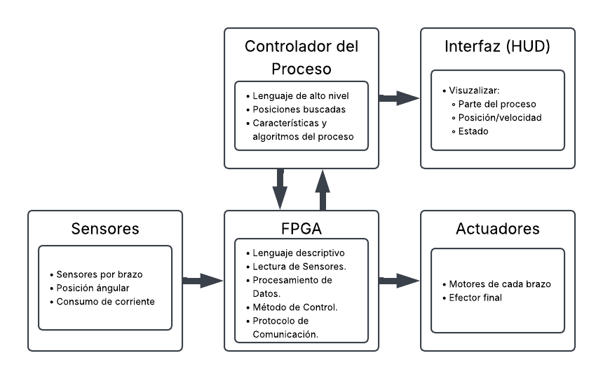

# Integración de Informe de Viabilidad

> **Proyecto:** Control de Robot Delta Mediante FPGA  
> **Carrera:** Licenciatura en Ingeniería en Automatización  
> **Materia:** T.D.T.A. III — Semestre 2026-2  
> **Integrantes:** Pedro Emiliano Moreno Mendoza  
> **Docente:** Dr. Adriana Rojas Molina  
> **Unidad:** U2 Viabilidad  

---

## 1. Planteamiento del Problema y Justificación
Un robot paralelo es un robot compuesto de múltiples cadenas (brazos) que conectan una base fija con una base móvil. Un tipo de robot paralelo son los robots delta. Este tipo de robot paralelo se caracteriza por sus tres grados de libertad, derivados de sus 3 brazos, lo que le permite mantener la base fija siempre en paralelo con la base móvil.

En la actualidad, debido a la naturaleza fuertemente acoplada y no lineal de su cinemática, los controladores tradicionales basados en microcontroladores asíncronos procesan la información de forma secuencial, lo que provoca retardos no deseados al muestrear los sensores y accionar los motores, generando un cuello de botella que entorpece el control y reduce la precisión del robot en aplicaciones a mayor velocidad.

Para resolver este problema, se propone aprovechar las propiedades de los Field-Programmable Gate Arrays (FPGA) que poseen una ejecución síncrona y paralela basada en tiempos de reloj, lo que permite implementar un control multicapa que dirige los actuadores de forma simultánea. Al programar la FPGA a bajo nivel mediante lenguajes de descripción de hardware puro, se pueden modelar los cálculos directamente en circuitos de silicio (digitales), evitando los cuellos de botella de los procesadores secuenciales y logrando velocidades altas sin sacrificar la precisión característica del robot delta.

## 2. Objetivo Preliminar
Implementar un sistema de control multicapa para un robot paralelo tipo delta mediante un dispositivo FPGA, programándolo exclusivamente en lenguajes de descripción de hardware (VHDL o Verilog). El propósito es aplicar un control simultáneo a los tres actuadores para mitigar el conflicto entre ellos, reducir la fatiga mecánica y disminuir significativamente el error de seguimiento, logrando alta velocidad y precisión verificable.

## 3. Descripción y Representación Conceptual del Sistema
El sistema embebido se dividirá conceptualmente en los siguientes módulos, priorizando el rendimiento de hardware:

| Etapa / Componente | Descripción de la propuesta |
| :--- | :--- |
| **Controlador del Proceso** | Programado en lenguaje de alto nivel para definir las posiciones buscadas, así como las características y los algoritmos del proceso. |
| **Interfaz (HUD)** | Interfaz gráfica destinada a visualizar la parte del proceso en curso, la posición/velocidad y el estado general del sistema. |
| **Sensores** | Conjunto de sensores ubicados en cada brazo para medir variables físicas como la posición angular y el consumo de corriente. |
| **FPGA** | Implementación en lenguaje descriptivo (hardware) encargada de la lectura de sensores, procesamiento de datos, ejecución del método de control y gestión del protocolo de comunicación. |
| **Actuadores** | Elementos de salida compuestos por los motores ubicados en cada brazo y el efector final del sistema. |

## 4. Condiciones, Requisitos y Alternativas
Para que el desarrollo sea viable, debe cumplir con requisitos técnicos estrictos:
1. Implementación de sensores de alta resolución.
2. Uso de motores con torque suficiente para evitar oscilaciones.
3. Modelo matemático simplificado y fiel al prototipo funcional en aplicaciones de alta velocidad.
4. Método de control robusto ante variaciones de carga.
   
Todo esto bajo las restricciones de:
1. Operar bajo la arquitectura delta.
2. Integrar una etapa de potencia adecuada.
3. Usar exclusivamente una FPGA como procesador central de control.

Durante el análisis se compararon las siguientes alternativas tecnológicas que podrían lograr de forma eficaz el control de un robot delta a altas velocidades:
1. **Microcontrolador secuencial (Propósito general o DSP):** Fácil de programar y con mucha documentación, pero genera un cuello de botella en muestreo/control a altas velocidades, arriesgando la precisión.
2. **Distribución de tareas entre distintos microcontroladores:** Emula el paralelismo usando múltiples chips dedicados. Aunque simplifica la programación, aumenta el consumo energético, la complejidad del hardware provisional y depende fuertemente de la velocidad del protocolo de comunicación entre microcontroladores.

Los criterios de comparación para validar el éxito de la propuesta son:
1. Determinismo del sistema.
2. Velocidad máxima sin arrastre de errores.
3. Escalabilidad matemática para distintas dimensiones del robot.
4. Bloques lógicos requeridos (CLBs) y robustez del control.

## 5. Interesados, Beneficiarios y Contexto
El desarrollo de este proyecto se inserta en el ecosistema de investigación de la Facultad de Ingeniería de la UAQ, involucrando distintas figuras clave:

| Interesado | Relación con el proyecto | Necesidad o expectativa | Influencia | Evidencia o fuente |
| :--- | :--- | :--- | :--- | :--- |
| Docente Titular de TDTA | Administra el proyecto y evalúa. | Entregables a tiempo y funcionales. | Alta | Rúbrica de evaluación. |
| Asesor de Proyecto | Asesora de forma técnica guiando con su experiencia. | Consultas constantes e interés en presentar resultados. | Alta | Contacto directo. |
| Centros de Investigación y Laboratorios | Proveen infraestructura y equipo especializados. | Respeto a sus protocolos; alineación a sustentabilidad/tecnología. | Alta | Página web de la FI UAQ. |
| Doctores Investigadores FI | Asesoran problemas técnicos puntuales. | Consultas concisas que no interfieran con sus proyectos. | Media | Directorio de Investigadores FI |
| Equipo del proyecto | Integran y desarrollan el proyecto. | Desarrollar un proyecto que sirva para las materias y permita hacer un trabajo de investigación. | Alta | Consenso del equipo |
| Usuarios directos. Lectores del artículo o tesis. | Utilizarán el proyecto para otras investigaciones. | Presentar materiales de forma ordenada y bien documentada | Baja | |

## 6. Límites Preliminares
* El modelado genera matrices de ecuaciones diferenciales de alta complejidad que representan un desafío técnico para el nivel actual del equipo.
* Alteraciones del modelo matemático y limitaciones de las simplificaciones al incrementar la velocidad de operación.
* La sintonización del control y el procesamiento experimentan mayor dificultad conforme se aumenta la velocidad operativa.
* Restricciones de tiempo marcadas por el calendario escolar y la disponibilidad/reglamentos de los laboratorios de la universidad.

## 7. Información Pendiente de Confirmar
Para avanzar a las fases de diseño y desarrollo, se deben considerar los siguientes aspectos:
* El modelo exacto y familia de la FPGA a utilizar (con procesamiento suficiente).
* Los componentes físicos definitivos (tipo de motores, encoders, drivers síncronos y materiales mecánicos del chasis).
* La flexibilidad del software para adaptar cambios en las dimensiones del robot delta.
* La estrategia de control definitiva, el formato de precisión de datos.
* La metodología y el software de simulación que se empleará para verificar el código HDL y la cinemática antes de las pruebas físicas.
* La definición formal de los Doctores Investigadores de la FI que participarán como consultores y el formato del documento final a publicar (tesis o artículo).
